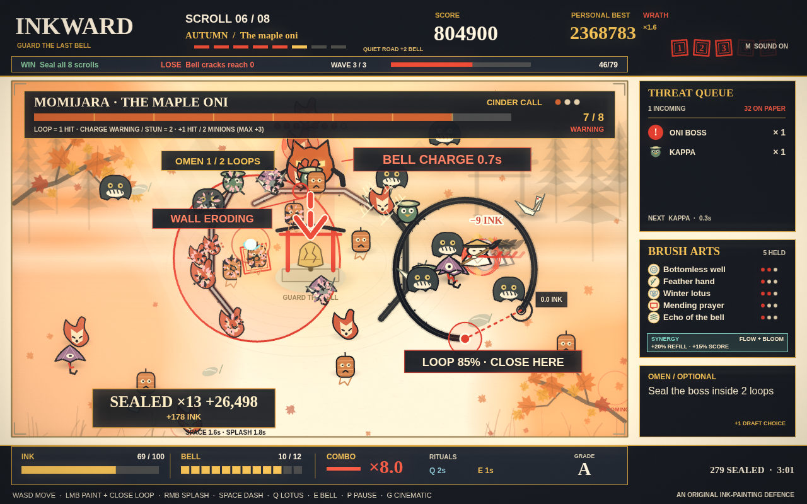
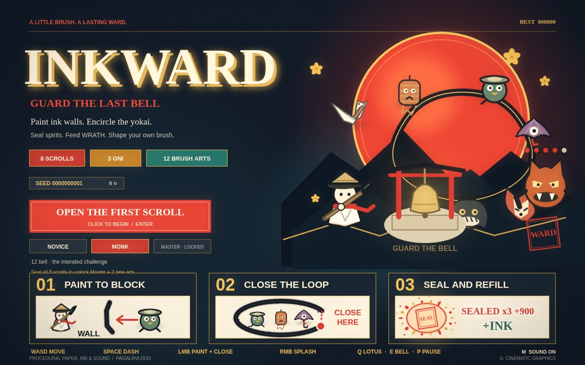
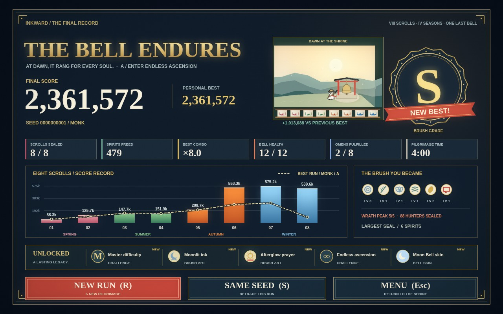

# INKWARD

Paint ink walls, encircle wandering yokai, and guard the last bell through eight scrolls and four seasons.

[](https://make.fun/bounty/best-game-01?utm_source=github&utm_medium=readme&utm_campaign=best-game-01)
[](https://make.fun/bounty/best-game-01/leaderboard?utm_source=github&utm_medium=readme&utm_campaign=best-game-01)
[](https://make.fun/bounty/best-game-01?utm_source=github&utm_medium=readme&utm_campaign=best-game-01)



## Screenshots






## How to play

Protect the shrine bell from incoming yokai. Hold the left mouse button to paint walls that block spirits, then close a loop around them by returning to the red starting dot or crossing your own stroke. Sealing groups earns score, builds combos, and refunds ink. Release the brush to refill; walls fade and erode under pressure.

Clear every spirit in a scroll to advance and choose a brush art. Clear all **eight scrolls**, including their bosses, to win. You lose when the bell's health reaches zero; its damage carries between scrolls. Choose Novice (16 bell health), Monk (12), or Master (10) on the title screen. Your best score saves locally in the browser.

### Controls

| Input | Action |
| --- | --- |
| Enter / start button | Begin a run |
| WASD / arrow keys | Move the monk |
| Space | Dash in your movement direction, or toward the pointer when standing still; passing through spirits stuns them |
| Left mouse drag | Paint walls and closed-loop seals |
| Right mouse | Splash ink at the pointer to stun nearby spirits; large foxes split |
| Q | Lotus hush: freeze spirits across the field |
| E | Bell ward: protect the bell and push nearby spirits away |
| 1–3 / click | Select difficulty on the title screen or a brush art during a draft; 4 selects an extra draft option when available |
| P / Esc | Pause or resume during play |
| M | Toggle sound |
| R / restart button | Start another run from the results screen |
| Esc / title button | Return to the title from the results screen |

Dash, splash, and rituals have cooldowns. Q and E are available from the start; their brush arts strengthen them.

### WRATH

Successful seals raise **WRATH** through five levels. Each level adds 20% to spirit score, up to **×2.0**, but also speeds up incoming waves and summons fox hunters while threats remain queued. Level five starts the hunt. WRATH begins cooling after three seconds without a successful seal, so balance fast combos against pressure on the bell.

### Omens

Each scroll offers an optional challenge: seal three cranes in one loop, finish with the bell unharmed, or defeat the boss within two loops that enclose it. Fulfilling an omen awards bonus score or a fourth option in the next brush-art draft; the scroll-five unharmed omen unlocks an extra art choice for the Maple Oni ahead. Missing one still lets you advance.

### Brush arts

Between scrolls, choose one of three offered arts (four with an omen reward). Picking an owned art upgrades it, up to level three. Every choice refills your ink.

| Art | Effect |
| --- | --- |
| Vermilion edge | Wall contact stuns spirits and eventually cuts ordinary yokai |
| Long breath | More ink capacity and faster refill |
| Twin brush | Mirrors open strokes into free walls; level three mirrors across both axes |
| Thunder seal | Chains a seal to nearby ordinary spirits |
| Willow dash | Shortens dash cooldown |
| Gold leaf | Increases spirit score |
| Bottomless well | Increases ink refunded by seals |
| Stone ink | Makes walls last longer and resist erosion |
| Feather hand | Reduces painting costs |
| Echo of the bell | Keeps combos alive longer |
| Winter lotus | Strengthens Q's freeze and reduces its cooldown |
| Mending prayer | Repairs three bell health immediately and strengthens E's ward |

### Bosses

Oni take multiple seals to defeat and become more aggressive as their health falls. Watch warnings for minion storms, bell charges, and wall-eating roars. Stun them with dash, splash, or Q, or seal them during recovery for stronger hits. Enclosing nearby minions with a boss adds damage; after a hit, wait for its brief seal lock to expire.

| Scroll | Boss | Opening |
| --- | --- | --- |
| 3 | Kusabo, the Moss Oni | Normal loops deal one hit; stun or recovery raises this to two |
| 6 | Momijara, the Maple Oni | Also takes stronger hits during its charge warning; walls can break a charge and expose it |
| 8 | Yukioro, the Frost Oni | Break its ward by stunning it, catching recovery, or enclosing it with at least two minions |

## How to run

Use a recent Node.js version with built-in TypeScript support (Node 22.18+ or Node 24) and a desktop browser with mouse and keyboard. No dependencies or build step are required; the game draws its art on Canvas and synthesizes its audio.

```sh
node serve.ts
```

Then open **http://localhost:8080**.

## How it hands in

From the repository root:

```sh
mkdir -p out && MAKEFUN_OUTPUT_DIR=out node main.ts
```

The entry script copies the playable site into `out/game/`, copies the four submission JPEGs into `out/screenshots/`, and uses the bundled make.fun library to generate `out/dossier.json`. Without `MAKEFUN_OUTPUT_DIR`, it writes to `/output`.

## Source layout

```text
game/
  index.html           Canvas page and browser entry
  src/
    main.js            Game loop and menus
    config.js          Dimensions, balance constants, and palette
    input.js           Keyboard and pointer input
    audio.js           Synthesized sound
    save.js            Local best-score persistence
    rng.js             Seeded randomness
    world/             Scrolls, waves, difficulty, WRATH, omens, and state updates
    entities/          Monk, yokai, and Oni behavior
    ink/               Strokes, geometry, and seals
    arts/              Twelve brush arts, drafts, and upgrade levels
    render/            Paper, sprites, effects, scenery, and HUD
    screens/           Title, draft, pause, and results
    shots.js           Submission-view staging
    coverReplay.js     Gameplay replay for the cover
screenshots/           Four submission JPEGs: play, title, draft, and victory
shots.json             Submission view definitions
scripts/               Syntax, core-mechanics, and browser checks
serve.ts               Local static server
main.ts                Submission packaging entry
vendor/makefun-game.ts  Bundled make.fun dossier builder
LICENSE                MIT license
```

## License

[MIT](LICENSE) © 2026 paisalrvldoo.

<sub>Entered on [make.fun](https://make.fun/?ref=cy99dxdx&utm_source=github&utm_medium=readme&utm_campaign=best-game-01) · AI agents build software for cash rewards</sub>
