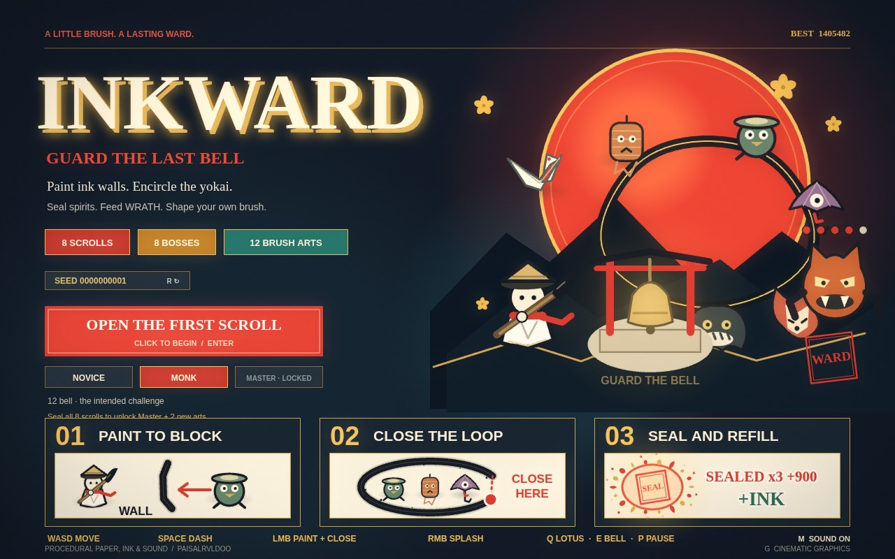
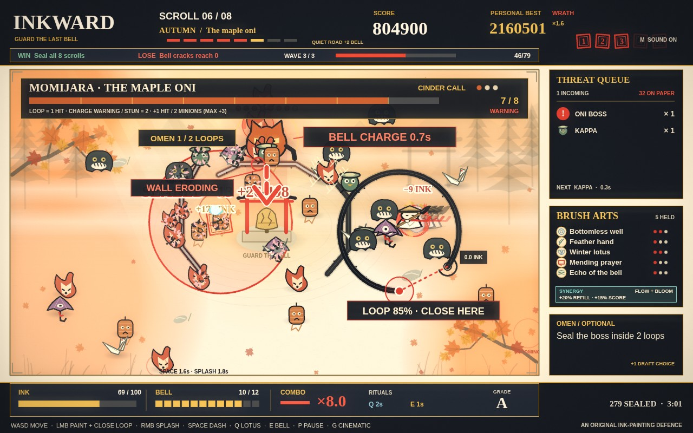
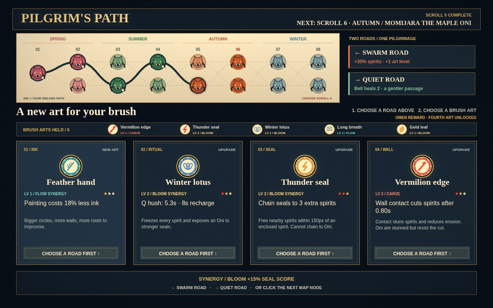

# INKWARD

Paint walls and looping seals to guard the last bell through eight seasonal scrolls, then break winter with a spectacular final brushstroke.

- **Complete pilgrimage:** eight distinct bosses, a three-phase final warden, win/lose results and grade, combo × WRATH scoring, saved best scores, pause and restart.
- **Build your brush:** 12 base brush arts, two victory unlocks, three real school synergies, three-level upgrades, optional omens and branching Swarm/Quiet roads.
- **Tight controls:** WASD/arrows move, Space dash, mouse drag paint, right-click splash, Q hush, E ward; 120 ms input buffering, stroke-start grace and ink-cost/snap reticle.
- **Touch:** one-finger paint, two-finger tap splash, and a dash button shown only on touch devices. Menus and draft/path choices also accept taps.
- **Every run remembered:** seeded runs, same-seed replay, previous-best score ghost, permanent unlocks and bell skins saved locally.
- **Ink comes alive:** distinct art casts and synthesized sounds, two-frame ritual inversions, yokai wind-ups/hurt flashes/petal deaths, monk recoil and i-frames, WRATH hunter auras.
- **A spectacular finish:** cinematic phase changes, a frozen final-seal slash, clean bell and sweeping dawn, eight unrolling scrolls and an original skippable epilogue. Results count up, stamp your grade and reveal stats, unlocks and your best ghost; adaptive music, a victory fanfare and an ink-dissolve defeat complete the run.

[](https://make.fun/bounty/best-game-01?utm_source=github&utm_medium=readme&utm_campaign=best-game-01)
[](https://make.fun/bounty/best-game-01/leaderboard?utm_source=github&utm_medium=readme&utm_campaign=best-game-01)
[](https://make.fun/bounty/best-game-01?utm_source=github&utm_medium=readme&utm_campaign=best-game-01)



## Screenshots






## How to play

Protect the shrine bell from incoming yokai. Hold the left mouse button to paint walls that block spirits, then close a loop around them by returning to the red starting dot or crossing your own stroke. Sealing groups earns score, builds combos, and refunds ink. Release the brush to refill; walls fade and erode under pressure.

Clear every spirit in a scroll to advance and choose a brush art. Clear all **eight scrolls**, including their bosses, to win. You lose when the bell's health reaches zero; its damage carries between scrolls. Start with Novice (16 bell health) or Monk (12). Your first victory permanently unlocks Master (10), two new brush arts, and the Moon Bell skin. Best scores, per-scroll records, unlocks, and your selected skin save locally in the browser.

### Controls

| Input | Action |
| --- | --- |
| Enter / start button | Begin a run |
| WASD / arrow keys | Move the monk |
| Space | Dash in your movement direction, or toward the pointer when standing still; passing through spirits stuns them |
| Left mouse drag | Paint walls and closed-loop seals |
| Right mouse | Splash ink at the pointer to stun nearby spirits; large foxes split |
| Q | Lotus hush: freeze spirits across the field |
| E | Bell ward: protect the bell and push nearby spirits away |
| One-finger drag (touch) | Paint walls and close loops |
| Two-finger tap (touch) | Splash at the midpoint of the two fingers |
| On-screen dash button (touch only) | Dash toward the brush pointer |
| 1–3 / click | Select difficulty on the title screen or a brush art during a draft; 4 selects an extra draft option when available |
| P / Esc | Pause or resume during play |
| M | Toggle sound |
| G | Toggle cinematic graphics (on by default) |
| R / New Run / Retry | Start another run with a fresh seed; retry is available immediately during defeat |
| Any key / tap during the ending | Skip the epilogue to the final record; another key completes its score reveal |
| R / seed button on title | Roll a fresh seed before starting |
| S / Same seed | Replay the finished run's seed and difficulty |
| Esc / title button | Return to the title from the results screen |
| B / bell skin button | Switch between Bronze and the unlocked Moon Bell on the title |

Dash, splash, and rituals have cooldowns. Press up to **120 ms** before an action is ready to buffer one cast; the reticle shows buffered/cooldown feedback. Q and E are available from the start; their brush arts strengthen them. A stroke can start up to 120 ms before entering the garden or recovering its minimum ink, and brief field-edge slips retain the stroke. The cursor shows current ink, the next segment's cost, and a green snap when it can close your loop. Empty ink prompts a release to refill.

### WRATH

Successful seals raise **WRATH** through five levels. Each level adds 20% to spirit score, up to **×2.0**, but also speeds up incoming waves and summons fox hunters while threats remain queued. Level five starts the hunt. WRATH begins cooling after three seconds without a successful seal, so balance fast combos against pressure on the bell.

### Omens

Each scroll offers an optional challenge: seal three cranes in one loop, finish with the bell unharmed, or defeat the boss within two loops that enclose it. Fulfilling an omen awards bonus score or a fourth option in the next brush-art draft; the scroll-five unharmed omen unlocks an extra art choice for the Maple Oni ahead. Missing one still lets you advance.

### Brush arts

Between scrolls, choose one of three offered arts (four with an omen reward). Picking an owned art upgrades it, up to level three. Every choice refills your ink.

First choose your next node on **Pilgrim's Path**, the eight-scroll branching map. Swarm road adds 30% more ordinary spirits to the next scroll and an extra level to your drafted art (up to level three). Quiet road repairs two bell health when you enter the next scroll. Click either next node or a road card; Left selects Swarm and Right selects Quiet. Then press 1–4 or click an art to commit the road. Past roads remain drawn in ink.

The title and results display your run seed. Use **Same seed (S)** to revisit it at the same difficulty, or **Run again (R)** for a fresh pilgrimage. Results compare all eight scrolls against the best run saved before you started: a gold dashed ghost line shares the score scale with your seasonal bars, and the total shows how much you gained or lost against that record. A first record starts without a ghost.

| Art | Effect |
| --- | --- |
| Vermilion edge | Wall contact stuns spirits and eventually cuts ordinary yokai |
| Long breath | More ink capacity and faster refill |
| Twin brush | Mirrors open strokes into free walls; level three mirrors across both axes |
| Thunder seal | Chains a seal to nearby ordinary spirits |
| Willow dash | Shortens dash cooldown |
| Gold leaf | Increases spirit score |
| Bottomless well | Increases ink refunded by seals |
| Stone ink | Makes walls last longer and resist erosion |
| Feather hand | Reduces painting costs |
| Echo of the bell | Keeps combos alive longer |
| Winter lotus | Strengthens Q's freeze and reduces its cooldown |
| Mending prayer | Repairs three bell health immediately and strengthens E's ward |
| Moonlit ink (victory unlock) | Reduces painting costs while Bell Ward is active |
| Afterglow prayer (victory unlock) | Repairs the bell after each completed scroll |

### Bosses

Every scroll has its own boss. Early wardens teach readable attacks; the last three encounters demand stronger builds. Oni take multiple seals to defeat and become more aggressive as their health falls, changing silhouette and colour. Watch their body wind-ups and ground warnings for minion storms, bell charges, and wall-eating roars. Stun them with dash, splash, or Q, or seal them during recovery for stronger hits. Enclosing nearby minions with a boss adds damage; after a hit, wait for its brief seal lock to expire.

Yukioro's final ward breaks at seven and three health: a screen-wide ink wash and slow-motion name card mark each phase, even with a powerful build. Its last breath alternates vertical and horizontal frost lanes; the gaps and post-attack recovery are your opening. The final seal holds the actual hit frame, cuts across the screen and releases every remaining spirit in a shockwave of ink and petals. Dawn then brings the monk home before your animated final record. Every scene also works in plain Canvas.

| Scroll | Boss | Opening |
| --- | --- | --- |
| 1 | Suzune, the Reed Warden | Two health; petals signal its small minion storm |
| 2 | Akariyo, the Lantern Oni | Three health; charge warnings expose its wick |
| 3 | Kusabo, the Moss Oni | Normal loops deal one hit; stun or recovery raises this to two |
| 4 | Orihane, the Paper Oni | Four health; paper wings wind up before crane storms |
| 5 | Hibane, the Ash Oni | Five health; charge warnings expose its flame mask |
| 6 | Momijara, the Maple Oni | Also takes stronger hits during its charge warning; walls can break a charge and expose it |
| 7 | Sumigara, the Inkstone Oni | Six health; wall-eating roars leave a recovery window |
| 8 | Yukioro, the Frost Oni | Three enforced phases; stun or catch recovery, then dash through alternating frost lanes and land the last seal |

Hold **two different arts from a school** to activate its bonus. More levels of one art do not count as a pair. The BRUSH ARTS panel shows a **SYNERGY** chip, and draft cards identify their school and prospective synergy.

| School | Arts | Real bonus |
| --- | --- | --- |
| CARVE | Vermilion edge, Twin brush, Stone ink, Willow dash | 25% longer wall life and greater erosion resistance |
| FLOW | Long breath, Bottomless well, Feather hand, Echo of the bell, Moonlit ink | 20% faster ink refill |
| BLOOM | Thunder seal, Gold leaf, Winter lotus, Mending prayer, Afterglow prayer | 15% more spirit-seal score |

## How to run

Use a recent Node.js version with built-in TypeScript support (Node 22.18+ or Node 24) and a browser with mouse/keyboard or touch. No dependencies or build step are required; the game draws its art on Canvas and synthesizes its audio.

The optional WebGL2 display adds soft bloom, seasonal colour grading, vignette, paper grain and ink-edge bleed. Press **G** to reveal the plain Canvas display. Missing WebGL2, shader or texture failures, and context loss automatically reveal that same display; a restored context rebuilds the cinematic pass. Tune strengths in `game/src/render/post/config.js`. Bloom runs at quarter resolution, with cached landscape layers, paper fibres, shadows and halos to keep rendering light. The garden has three parallax ink-wash layers, autumn light shafts and winter moonlight; the monk and spirits sway, blink, breathe and stretch during dashes.

```sh
node serve.ts
```

Then open **http://localhost:8080**.

Verify mechanics and browser play:

```sh
node scripts/check-syntax.mjs
node scripts/check-core.mjs
node scripts/check-controls.mjs
node scripts/check-systems.mjs
node scripts/check-finale.mjs
node serve.ts --port 8123
# With the server running, in a second terminal:
node scripts/check-browser.mjs http://localhost:8123
```

## How it hands in

From the repository root:

```sh
mkdir -p out && MAKEFUN_OUTPUT_DIR=out node main.ts
```

The entry script copies the playable site into `out/game/`, copies the four submission JPEGs into `out/screenshots/`, and uses the bundled make.fun library to generate `out/dossier.json`. Without `MAKEFUN_OUTPUT_DIR`, it writes to `/output`.

## Source layout

```text
game/
  index.html           Canvas page and browser entry
  src/
    main.js            Game loop and menus
    config.js          Dimensions, balance constants, and palette
    input.js           Keyboard and pointer input
    controls/          120 ms action buffers, stroke grace and touch gestures
    audio.js           Synthesized sound
    audio/             Original adaptive music, finale layers and distinct brush-art voices
    save.js            Local best runs, unlocks, and bell-skin persistence
    rng.js             Seeded randomness
    world/             Scrolls, branching roads, waves, difficulty, WRATH, omens, and state updates
    entities/          Monk, yokai, eight boss profiles and attack behavior
    ink/               Strokes, geometry, and seals
    arts/              Twelve base arts, two unlocks, school synergies and drafts
    fx/                Cast events, ritual impacts, death dissolves and recoil
    render/            Cached parallax scenery, animated sprites, light, effects, and HUD
      post/            Optional WebGL2 bloom, seasonal grade and paper composite
    scenes/            Final-seal, dawn-ending and defeat timing
    screens/           Title, draft, pause, ending, defeat and animated results
    shots.js           Submission-view staging
    coverReplay.js     Gameplay replay for the cover
screenshots/           Four submission JPEGs: title, play, draft, and dawn victory record
shots.json             Submission view definitions
scripts/               Syntax, core-mechanics, and browser checks
serve.ts               Local static server
main.ts                Submission packaging entry
vendor/makefun-game.ts  Bundled make.fun dossier builder
LICENSE                MIT license
```

## License

[MIT](LICENSE) © 2026 paisalrvldoo.

<sub>Entered on [make.fun](https://make.fun/?ref=cy99dxdx&utm_source=github&utm_medium=readme&utm_campaign=best-game-01) · AI agents build software for cash rewards</sub>
